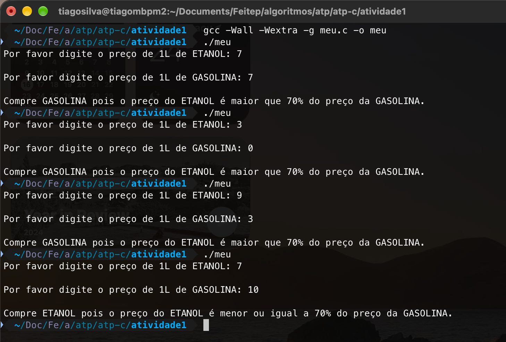
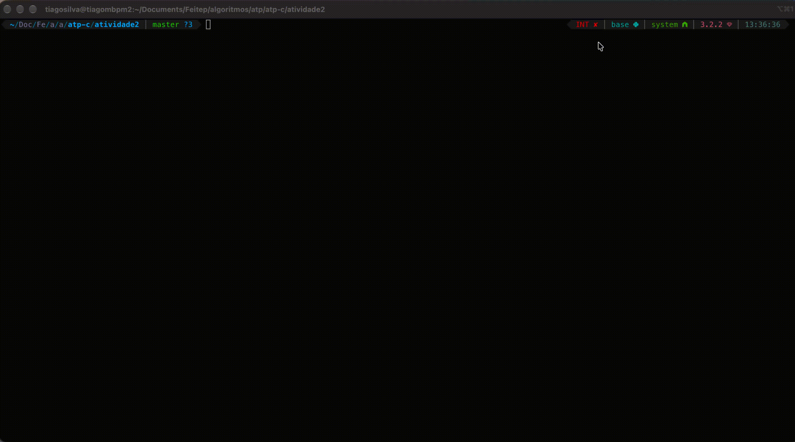

# Sistema de Abastecimento de Combustíveis

Projeto desenvolvido em linguagem C para a disciplina de **Algoritmos e Linguagem de Programação**, do curso de Engenharia de Computação da UniFEITEP.

<p align="center">
  <a href="atp-enunciado.pdf" download="atp-enunciado.pdf">
    
  </a>
</p>

<p align="center">
  <br>
  <em>Atividade 1 — comparação entre etanol e gasolina</em>
</p>

<p align="center">
  <br>
  <em>Atividade 2 — sistema de abastecimento</em>
</p>

## Descrição

O programa simula o cálculo do valor de um abastecimento de álcool e gasolina, aplicando descontos de acordo com o tipo de cliente.

O utilizador informa os preços dos combustíveis, seleciona o tipo de cliente e indica as quantidades abastecidas.

O programa apresenta os valores originais, os descontos aplicados e o total a pagar.

## Tipos de cliente e descontos

| Tipo de cliente | Desconto |
|---|---|
| Motorista de Aplicativo | 6% |
| Frota de Carros | 5% |
| Cliente Comum | 3% |

O desconto é aplicado apenas quando a quantidade abastecida de cada combustível é igual ou superior a 30 litros.

## Conceitos utilizados

- Estrutura de repetição `do...while`
- Estrutura condicional `switch...case`
- Estrutura condicional `if...else`
- Funções
- Variáveis e operações matemáticas
- Entrada e saída de dados com `scanf()` e `printf()`

## Compilação e execução

O programa foi desenvolvido e testado no macOS utilizando GCC.

**Compilar:**

```bash
gcc -Wall -Wextra -g atp-2.c -o atp-2
```

**Executar:**

```bash
./atp-2
```

Para compilar noutros sistemas com GCC, pode ser necessário adaptar o comando `system("clear")`, utilizado para limpar o terminal.

## Observações

O menu foi desenvolvido para receber opções numéricas inteiras (1, 2 ou 3). Nesta fase, não foi implementada a validação de entradas não numéricas.

## Informações académicas

- **Instituição:** UniFEITEP
- **Curso:** Engenharia de Computação
- **Disciplina:** Algoritmos e Linguagem de Programação
- **Atividade:** ATP - Atividade 2
- **Linguagem:** C
- **Data:** 17/11/2026

<p align="center">
  <a href="atp-resolucao.pdf" download="atp-resolucao.pdf">
    
  </a>
</p>

